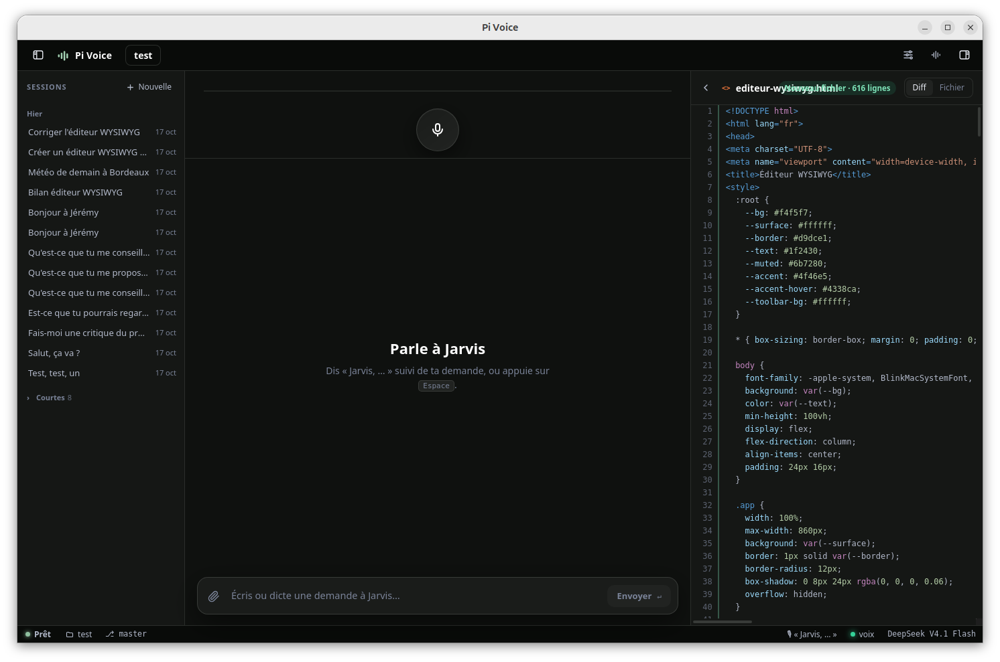

# Pi Voice

Surcouche vocale pour [pi](https://github.com/earendil-works/pi), un agent de code. Tu lui parles, tu vois ton texte s'écrire en direct, pi travaille juste à côté, puis il te répond à voix haute. Un égaliseur s'anime pendant qu'il parle, et `Espace` lui coupe la parole à tout moment.



| Apparence : mode, visualisation de la voix, palettes | Voix : choix de la voix, lecture vocale, agent vocal |
|---|---|
|  |  |

Tout est open source et tourne en local. Seul le modèle de langage reste celui que pi utilise déjà.

| Brique | Outil | Licence |
|---|---|---|
| App de bureau | Tauri 2 (Rust) + Svelte 5 (TypeScript) | MIT / Apache-2.0 |
| Agent | `pi --mode rpc` | MIT |
| Transcription (STT) | NVIDIA Parakeet TDT 0.6B v3 (processeur, `scripts/parakeet-stt-server.py`) | CC-BY 4.0 |
| Synthèse (TTS) | Kyutai Pocket TTS (processeur, `scripts/pocket-tts-server.py`) | MIT (code), selon la voix |

## Prérequis (une seule fois)

```bash
# Rust (déjà installé dans ~/.cargo si tu as suivi la mise en place)
wget -qO- https://sh.rustup.rs | sh

# Dépendances système de Tauri + audio
sudo apt install libwebkit2gtk-4.1-dev libsoup-3.0-dev libjavascriptcoregtk-4.1-dev \
  libssl-dev librsvg2-dev libayatana-appindicator3-dev libasound2-dev

npm install
```

Pour la voix, il faut seulement `uv` : la transcription et la synthèse tournent sur le processeur, sans GPU.

## pi

Pi Voice a son propre pi, comme harn : il n'utilise jamais le pi installé sur la machine.

- `runtime/pi` : `@earendil-works/pi-coding-agent`, version fixée dans `scripts/setup-pi.sh`. L'assistant de démarrage lance ce script ; pour monter de version, change `PI_VERSION` et relance-le.
- `data/pi-agent` : sa config (connexion, modèles, sessions), transmise à pi par `PI_CODING_AGENT_DIR`. À sa création, l'app y copie `auth.json`, `models.json` et `settings.json` depuis `~/.pi/agent` s'ils existent ; les sessions ne sont pas reprises.

Les deux dossiers sont ignorés par git. `PI_BIN` et `PI_CODING_AGENT_DIR` permettent d'imposer un autre pi ou une autre config.

## Lancer

```bash
scripts/install-desktop.sh   # une fois : ajoute « Pi Voice » au menu des applications
```

Ensuite, lance **Pi Voice depuis le menu** (ou épingle-la au dock). L'app :
- démarre elle-même les serveurs vocaux s'ils ne tournent pas (prêts en ~15 s, plus longtemps la toute première fois, le temps de télécharger les modèles, ~3 Go) ;
- les arrête quand tu la fermes. Ils n'utilisent pas le GPU, qui reste entier pour le modèle de langage. Des serveurs que tu as lancés toi-même ne sont jamais arrêtés ;
- rouvre le dernier projet. `Ctrl+O` en ouvre un autre.

En ligne de commande : `scripts/run.sh [dossier]`, ou `scripts/run.sh dev` en mode développement. `scripts/run.sh` nettoie les variables qu'un éditeur installé en snap (VSCodium, VS Code) transmet à son terminal : sans ça, WebKitGTK plante au démarrage. Les serveurs seuls : `scripts/voice-server.sh`. Le journal du démarrage de la voix est dans `~/.cache/pi-voice/voice-server.log`.

Pour vérifier la voix seule : `uv run scripts/test-voice.py`. Il fait dire une phrase au TTS, puis la redonne au STT.

## Utilisation

- **Micro** (ou `Espace`) : parle, et le texte s'écrit dans la zone du bas, phrase par phrase (à chaque pause). Quand tu fais une pause, une barre se remplit pendant 0,9 s puis le texte est envoyé. Pendant ce délai, clique dans le texte ou tape pour le corriger avant l'envoi.
- Un second clic sur le micro (ou `Espace`) envoie tout de suite, ~0,3 s après, le temps de transcrire la fin.
- **Le micro n'écoute que sur demande** (`Espace` ou clic), jamais pendant que pi parle. Appuyer sur `Espace` pendant qu'il parle coupe sa voix et ouvre le micro.
- **Agent vocal** (réglages, onglet Voix) : ce que tu dictes passe d'abord par lui. Il répond tout de suite, même pendant que pi travaille : il dit où en est pi, transmet à pi ce qui touche au projet (nouvelle demande, ou consigne en cours de route), ou arrête pi. Il tourne sur un serveur compatible OpenAI, par défaut [harn](../harn) (le modèle déjà chargé, sur un slot réservé, sans réflexion) ; la clé est lue dans `data/pi-agent/models.json`. Ce que tu tapes au clavier va toujours directement à pi.
- **Pendant que pi travaille**, sans agent vocal : ce que tu dis est envoyé comme consigne (`steer`). Il la prend en compte au prochain tour, sans perdre son travail.
- Dire **« stop »** (ou « arrête ») ou appuyer sur `Ctrl+.` arrête pi net.
- `Échap` coupe la voix, annule l'envoi automatique ou ferme le micro.
- `Ctrl+O` ouvre un autre projet.
- **À gauche**, l'arbre des fichiers avec leur état git. Un point lumineux marque les fichiers que pi a touchés pendant la session.
- **À droite**, le diff du fichier par rapport au dernier commit. Il suit automatiquement le dernier fichier modifié par pi, sauf si tu en as ouvert un toi-même.

### Ce qui est lu à voix haute

L'app ajoute une consigne au prompt de pi : terminer sa réponse finale par un court résumé oral entre les balises `<oral>…</oral>`. La synthèse vocale démarre dès que ce bloc commence à arriver, sans attendre la fin du texte. S'il n'y a pas de bloc `<oral>`, l'app lit le début de la réponse, sans le code.

## Réglages (icône en haut à droite)

- Voix : Estelle (française, par défaut) ou l'une des 26 autres voix de Pocket TTS, qui gardent le timbre de leur langue d'origine. Le bouton « Écouter » les fait entendre.
- Modèle (ceux que ta config de pi connaît), voix, lecture vocale, agent vocal.
- Adresses des serveurs STT et TTS.

## Architecture

```
src/                     Interface Svelte
  App.svelte             Orchestration : micro, envoi, raccourcis
  lib/session.svelte.ts  Reconstruit la conversation à partir des événements de pi
  components/            Égaliseur, micro, conversation, arbre, diff, réglages
src-tauri/src/
  pi.rs                  Processus `pi --mode rpc`, JSONL découpé sur LF uniquement
  voice.rs               Clients STT/TTS, fin de tour, interruption, anti-écho
  voice/agent.rs         Agent vocal : répond, transmet à pi ou l'arrête
  speech.rs              Extraction du bloc <oral> pendant le streaming
  audio.rs               Micro et haut-parleur (cpal), rééchantillonnage, FFT de l'égaliseur
  files.rs               Arbre (.gitignore respecté), git status, diff, surveillance du dossier
scripts/voice-server.sh  Lance la transcription (8090) et la synthèse (8089)
scripts/parakeet-stt-server.py  Transcription Parakeet, au protocole du STT Kyutai
scripts/pocket-tts-server.py    Synthèse Pocket TTS, au protocole du TTS Kyutai
```

Tout l'audio passe par Rust. L'égaliseur reçoit environ 45 fois par seconde 40 bandes de fréquence calculées par FFT. Elles sont dessinées en miroir (graves au centre), et deviennent une ligne de points dans le silence.

## Limites connues

- **Écho.** Le micro n'écoute pas pendant que pi parle. Juste après une coupure, un filtre ignore les mots que pi venait de dire.
- **Micro.** Le flux du micro reste ouvert pour démarrer sans délai, mais ses mots ne comptent qu'après `Espace`. L'audio ne va qu'au serveur local.
- **Voix limitées.** Pocket TTS n'utilise que les voix de son catalogue. Le clonage d'une voix demande d'accepter les conditions du modèle sur Hugging Face.
