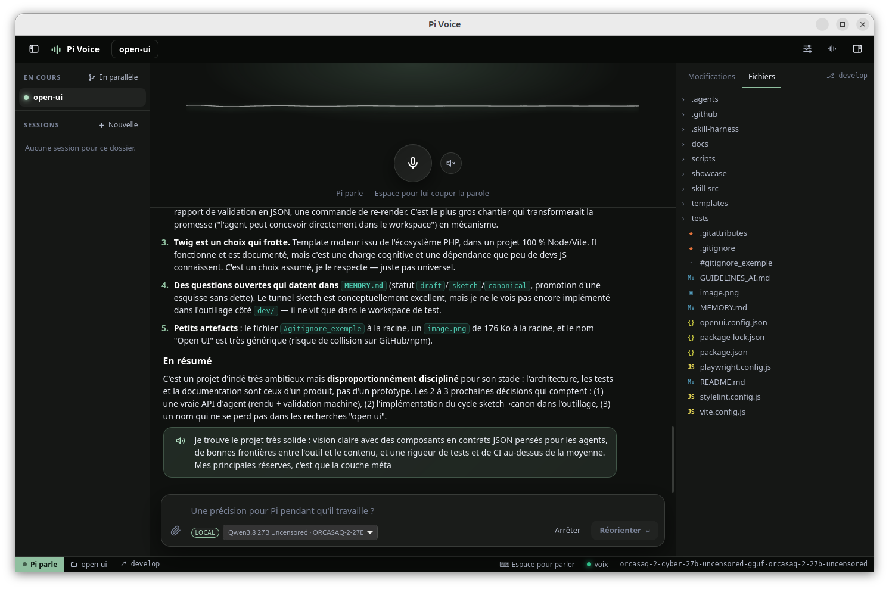
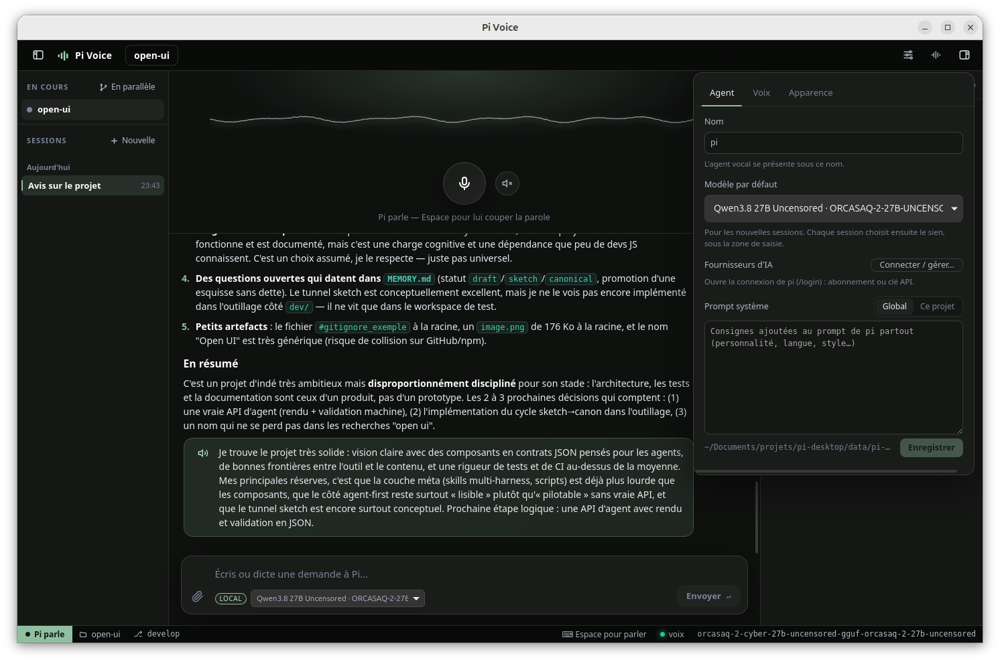
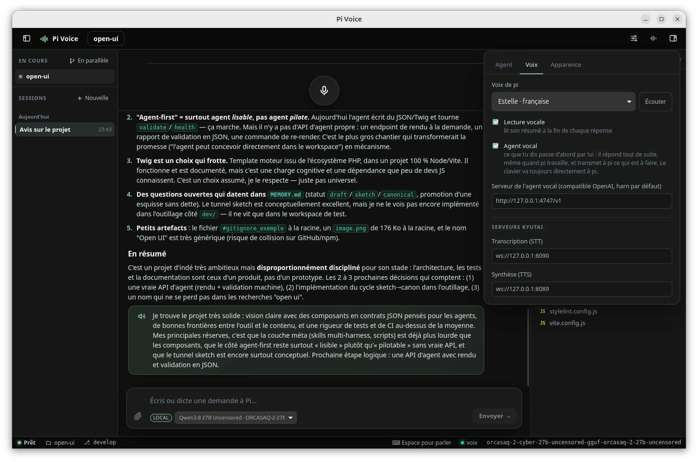
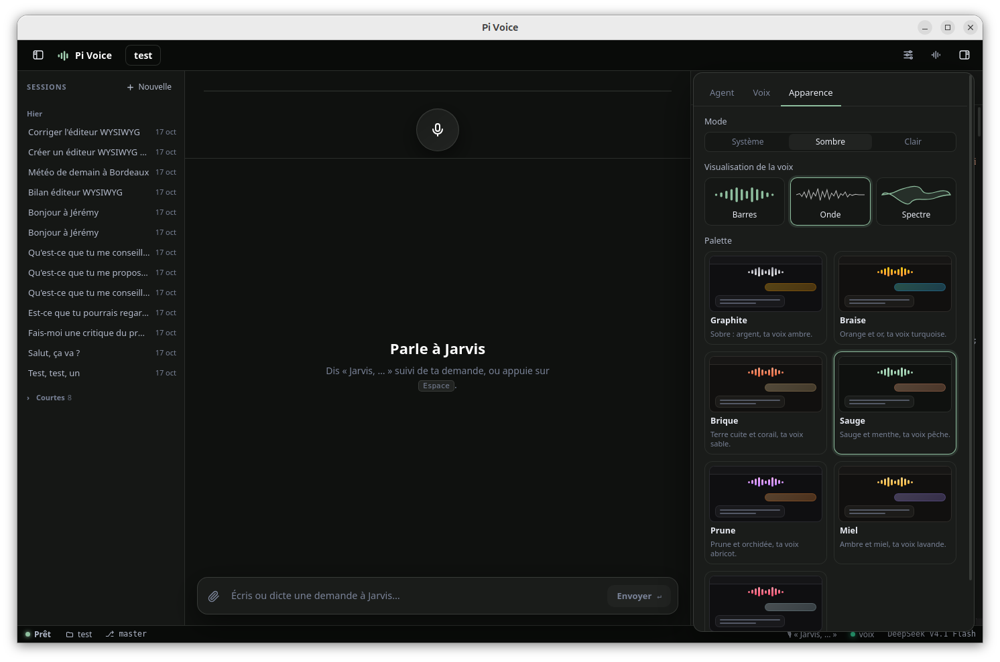

# Pi Voice

Surcouche vocale pour [pi](https://github.com/earendil-works/pi), un agent de code. Tu lui parles, tu vois ton texte s'écrire en direct, pi travaille juste à côté, puis il te répond à voix haute. Un égaliseur s'anime pendant qu'il parle, et `Espace` lui coupe la parole à tout moment.



| Agent : nom, modèle, fournisseurs, prompt système | Voix : choix de la voix, lecture vocale, agent vocal | Apparence : mode, visualisation de la voix, palettes |
|---|---|---|
|  |  |  |

Tout est open source et tourne en local. Seul le modèle de langage reste celui que pi utilise déjà.

| Brique | Outil | Licence |
|---|---|---|
| App de bureau | Tauri 2 (Rust) + Svelte 5 (TypeScript) | MIT / Apache-2.0 |
| Agent | `pi --mode rpc` | MIT |
| Transcription (STT) | NVIDIA Parakeet TDT 0.6B v3 (processeur, `scripts/parakeet-stt-server.py`) | CC-BY 4.0 |
| Synthèse (TTS) | Kyutai Pocket TTS (processeur, `scripts/pocket-tts-server.py`) | MIT (code), selon la voix |

## Prérequis (une seule fois)

```bash
# Rust (déjà installé dans ~/.cargo si tu as suivi la mise en place)
wget -qO- https://sh.rustup.rs | sh

# Dépendances système de Tauri + audio
sudo apt install libwebkit2gtk-4.1-dev libsoup-3.0-dev libjavascriptcoregtk-4.1-dev \
  libssl-dev librsvg2-dev libayatana-appindicator3-dev libasound2-dev

npm install
```

Pour la voix, il faut seulement `uv` : la transcription et la synthèse tournent sur le processeur, sans GPU.

## pi

Pi Voice a son propre pi, comme harn : il n'utilise jamais le pi installé sur la machine.

- `runtime/pi` : `@earendil-works/pi-coding-agent`.
- Deux outils, branchés à pi comme serveurs MCP (`data/pi-agent/mcp.json`, réécrit à chaque démarrage de l'app) :
  - `runtime/ketch` : [ketch](https://github.com/1broseidon/ketch), recherche web, docs de librairies, code open source et lecture de pages, sans clé API. Sa config est dans `data/ketch`.
  - `runtime/playwright` : [Playwright MCP](https://github.com/microsoft/playwright-mcp), un Chromium que pi pilote (ouvrir une page, cliquer, capturer…). Il s'ouvre dans une fenêtre visible : tu vois pi naviguer et tu peux cliquer ou taper dedans pour l'aider (connexion, captcha…). Son profil est gardé dans `data/playwright/profile`. Ses outils sont chargés à la demande. Les captures vont dans `data/playwright`, le navigateur dans `~/.cache/ms-playwright`.
- Les versions sont fixées en tête de `scripts/setup-pi.sh`, que lance l'assistant de démarrage. Pour en changer, modifie-les et relance le script : ce qui est déjà à jour est sauté.
- `data/pi-agent` : sa config (connexion, modèles, sessions), transmise à pi par `PI_CODING_AGENT_DIR`. À sa création, l'app y copie `auth.json`, `models.json` et `settings.json` depuis `~/.pi/agent` s'ils existent ; les sessions ne sont pas reprises.

Les deux dossiers sont ignorés par git. `PI_BIN` et `PI_CODING_AGENT_DIR` permettent d'imposer un autre pi ou une autre config.

## Lancer

```bash
scripts/install-desktop.sh   # une fois : ajoute « Pi Voice » au menu des applications
```

Ensuite, lance **Pi Voice depuis le menu** (ou épingle-la au dock). L'app :
- démarre elle-même les serveurs vocaux s'ils ne tournent pas (prêts en ~15 s, plus longtemps la toute première fois, le temps de télécharger les modèles, ~3 Go) ;
- les arrête quand tu la fermes. Ils n'utilisent pas le GPU, qui reste entier pour le modèle de langage. Des serveurs que tu as lancés toi-même ne sont jamais arrêtés ;
- rouvre le dernier projet. `Ctrl+O` en ouvre un autre.

En ligne de commande : `scripts/run.sh [dossier]`, ou `scripts/run.sh dev` en mode développement. `scripts/run.sh` nettoie les variables qu'un éditeur installé en snap (VSCodium, VS Code) transmet à son terminal : sans ça, WebKitGTK plante au démarrage. Les serveurs seuls : `scripts/voice-server.sh`. Le journal du démarrage de la voix est dans `~/.cache/pi-voice/voice-server.log`.

Pour vérifier la voix seule : `uv run scripts/test-voice.py`. Il fait dire une phrase au TTS, puis la redonne au STT.

## Utilisation

- **Micro** (ou `Espace`) : parle, et le texte s'écrit dans la zone du bas, phrase par phrase (à chaque pause). Quand tu fais une pause, une barre se remplit pendant 0,9 s puis le texte est envoyé. Pendant ce délai, clique dans le texte ou tape pour le corriger avant l'envoi.
- Un second clic sur le micro (ou `Espace`) envoie tout de suite, ~0,3 s après, le temps de transcrire la fin.
- **Le micro n'écoute que sur demande** (`Espace` ou clic), jamais pendant que pi parle. Appuyer sur `Espace` pendant qu'il parle coupe sa voix et ouvre le micro.
- **Agent vocal** (réglages, onglet Voix) : ce que tu dictes passe d'abord par lui. Il répond tout de suite, même pendant que pi travaille : il dit où en est pi, transmet à pi ce qui touche au projet (nouvelle demande, ou consigne en cours de route), ou arrête pi. Il tourne sur un serveur compatible OpenAI, par défaut [harn](../harn) (le modèle déjà chargé, sur le slot que pi n'utilise pas, sans réflexion) ; la clé est lue dans `data/pi-agent/models.json`. Ce que tu tapes au clavier va toujours directement à pi.
- **Pendant que pi travaille**, sans agent vocal : ce que tu dis est envoyé comme consigne (`steer`). Il la prend en compte au prochain tour, sans perdre son travail.
- Dire **« stop »** (ou « arrête ») ou appuyer sur `Ctrl+.` arrête pi net.
- `Échap` coupe la voix, annule l'envoi automatique ou ferme le micro.
- `Ctrl+O` ouvre un autre projet.
- **Plusieurs projets en même temps** : ouvre un autre projet (`Ctrl+O`), le premier continue de tourner. La liste « En cours » (à gauche) montre chaque run avec une pastille : travaille, attend ta réponse, a terminé, erreur, en pause. Seul le run affiché parle ; les autres te préviennent par une notification et un petit son quand ils finissent ou attendent ta réponse, et leur résumé est lu quand tu reviens sur eux.
- **Travail en parallèle sur un même projet** : « En parallèle », ou « Nouvelle » pendant que pi travaille, lance une session sur sa propre branche git (`pi/…`), dans un dossier de travail à part (`data/worktrees/`, copie du dernier commit). Les fichiers non suivis (`node_modules`, `.env`) n'y sont pas : pi réinstalle ce qu'il lui faut. Quand le travail est prêt, la barre au-dessus de la zone de saisie propose : **Fusionner** dans la branche du projet, **Garder la branche** (à fusionner plus tard avec git) ou **Abandonner**. En cas de conflit, rien ne bouge dans le projet et un bouton demande à pi de le résoudre sur sa branche.
- **Dots** (agents pi autonomes dans leur conteneur, projet [dots](../dots)) : un dot est un dossier (`<nom>.dot`, `skills/`, `extensions/`, `state/`) ; ceux de l'app vivent dans `data/dots/<nom>/`. La liste « Dots » à gauche lit ce dossier (nom et description viennent de l'en-tête du `.dot`, jamais de ses secrets) ; l'état allumé ou éteint, et les dots rangés ailleurs (groupe « Ailleurs »), viennent du script `dot`. Un clic se branche sur un dot (en l'allumant s'il le faut) et affiche sa conversation, celle qu'il partage avec Telegram et `./dot chat` ; le panneau de droite montre son `state/workspace/`. L'app lance `dot <dossier> rpc` à la place de `pi --mode rpc`, sans ses options (le dot a sa propre configuration) : la consigne vocale part donc avec chaque message (balise `<pi-voice>`, masquée à l'affichage). `+` crée un dot à partir d'un autre (mêmes accès et savoir-faire, sans son passé ni Telegram) ou vide. Le menu `⋯` l'allume ou l'éteint, le passe en mode RPC (nécessaire pour lui parler d'ici), range dans l'app un dot créé ailleurs, ouvre ses livrables, son dossier ou son `.dot`, ou le supprime. Le pi local reçoit le skill `integrations/pi-skill-dots`, `DOTS_CLI` et `DOTS_HOME=data/dots` : les dots que tu lui demandes de créer arrivent aussi dans l'app. **Fermer l'app éteint tous les dots allumés** (ils reprendront là où ils en étaient au prochain allumage). Le script `dot` est trouvé dans un dépôt `dots` voisin de l'app, sinon `DOTS_CLI`, sinon le réglage de l'onglet Agent.
- **Modèle par session** : sous la zone de saisie, chaque session choisit son modèle sans toucher aux autres (par exemple un modèle cloud pendant qu'un autre run occupe la carte graphique avec un modèle local ; l'appli te prévient si le modèle local choisi tourne déjà ailleurs). Le modèle des réglages sert de défaut aux nouvelles sessions.
- **Fermer l'app** pendant qu'un run travaille demande confirmation.
- **Aperçu** : quand pi fait quelque chose de visuel (page HTML, image, appli web), il te le montre dans le panneau de droite (outil `show_preview`, extension `pi-extensions/preview.ts`). Une adresse web (appli lancée sur `http://localhost:…`, site) s'ouvre dans un vrai navigateur posé sur le panneau (`browser.rs`, vue WebKitGTK), qui affiche aussi les pages qui refusent d'être intégrées ; une page HTML locale passe par un petit serveur intégré. Un clic sur une image, un `.html` ou un `.pdf` de l'arbre l'ouvre aussi en aperçu ; « Code » montre son diff, `Échap` ferme l'aperçu.
- **À gauche**, l'arbre des fichiers avec leur état git. Un point lumineux marque les fichiers que pi a touchés pendant la session.
- **À droite**, le diff du fichier par rapport au dernier commit. Il suit automatiquement le dernier fichier modifié par pi, sauf si tu en as ouvert un toi-même.

### Ce qui est lu à voix haute

L'app ajoute une consigne au prompt de pi : terminer sa réponse finale par un court résumé oral entre les balises `<oral>…</oral>`. La synthèse vocale démarre dès que ce bloc commence à arriver, sans attendre la fin du texte. S'il n'y a pas de bloc `<oral>`, l'app lit le début de la réponse, sans le code.

## Réglages (icône en haut à droite)

- Voix : Estelle (française, par défaut) ou l'une des 26 autres voix de Pocket TTS, qui gardent le timbre de leur langue d'origine. Le bouton « Écouter » les fait entendre.
- Modèle (ceux que ta config de pi connaît), voix, lecture vocale, agent vocal.
- Adresses des serveurs STT et TTS.

## Architecture

```
src/                     Interface Svelte
  App.svelte             Orchestration : micro, envoi, raccourcis
  lib/session.svelte.ts  Reconstruit la conversation à partir des événements de pi
  components/            Égaliseur, micro, conversation, arbre, diff, réglages
src-tauri/src/
  pi.rs                  Processus `pi --mode rpc`, JSONL découpé sur LF uniquement
  voice.rs               Clients STT/TTS, fin de tour, interruption, anti-écho
  voice/agent.rs         Agent vocal : répond, transmet à pi ou l'arrête
  speech.rs              Extraction du bloc <oral> pendant le streaming
  audio.rs               Micro et haut-parleur (cpal), rééchantillonnage, FFT de l'égaliseur
  browser.rs             Navigateur de l'aperçu : vue WebKitGTK en calque sur le panneau
  preview.rs             Serveur local de l'aperçu (127.0.0.1, dossiers confiés seulement)
  files.rs               Arbre (.gitignore respecté), git status, diff, surveillance du dossier
pi-extensions/           Extensions de pi chargées par l'app (--extension) : preview.ts (show_preview)
scripts/voice-server.sh  Lance la transcription (8090) et la synthèse (8089)
scripts/parakeet-stt-server.py  Transcription Parakeet, au protocole du STT Kyutai
scripts/pocket-tts-server.py    Synthèse Pocket TTS, au protocole du TTS Kyutai
```

Tout l'audio passe par Rust. L'égaliseur reçoit environ 45 fois par seconde 40 bandes de fréquence calculées par FFT. Elles sont dessinées en miroir (graves au centre), et deviennent une ligne de points dans le silence.

## Limites connues

- **Écho.** Le micro n'écoute pas pendant que pi parle. Juste après une coupure, un filtre ignore les mots que pi venait de dire.
- **Micro.** Le flux du micro reste ouvert pour démarrer sans délai, mais ses mots ne comptent qu'après `Espace`. L'audio ne va qu'au serveur local.
- **Voix limitées.** Pocket TTS n'utilise que les voix de son catalogue. Le clonage d'une voix demande d'accepter les conditions du modèle sur Hugging Face.
